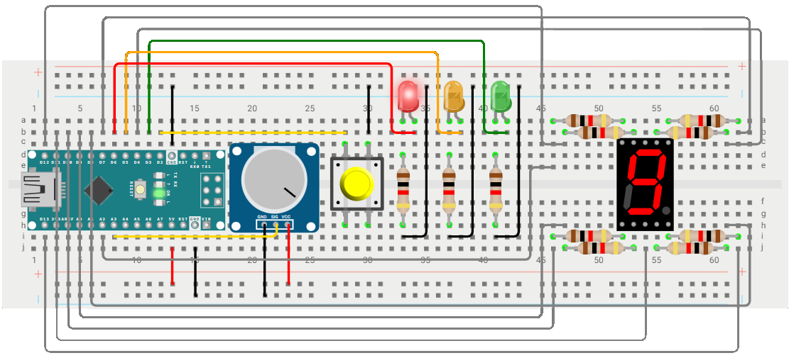

# AVRaffic Light 🚦

## Table of Contents

- [Description](#description)
    - [Project](#project)
    - [Repository](#repository)
    - [Technical Details](#technical-details)
- [Circuit Diagram](#circuit-diagram)
- [Acknowledgements](#acknowledgements)
- [License](#license)

## Description

### Project
**AVRaffic Light** demonstrates the operation of a traffic light circuit controlled by an *ATmega328P* microcontroller, with user input provided via a push-button and a potentiometer to drive a series of light-emitting diodes (LEDs). The firmware is written in bare-metal *C*, with the purpose of understanding embedded systems and hardware-level programming beyond the abstractions of the commonly used *Arduino* interface. Specifically, the development of this project covers the exploration of the following fundamental concepts:

- *Analog-to-Digital Converters (ADCs)*
- *Callbacks*
- *Finite State Machines (FSMs)*
- *General Purpose Input/Output (GPIO)*
- *Hardware Abstraction Layer (HAL)*
- *Interrupt Requests (IRQs)*
- *Interrupt Service Routines (ISRs)*
- *Polling*
- *Pulse Width Modulation (PWM)*
- *Software Debouncing*
- *Timers*
- *Universal Asynchronous Receiver/Transmitter (UART)*

You can interact directly with this prototype traffic light circuit on the dedicated [*Wokwi* simulator project page](https://wokwi.com/projects/454427813664155649).

### Repository
The code in this repository is organized into two directories, namely [*include*](include) and [*src*](src), which contain the header (`.h`) and source (`.c`) files of the project, respectively.

### Technical Details
This project was developed using *Visual Studio Code* on `Windows 10`, with the *PlatformIO* extension employed to upload the code to the *ATmega328P* microcontroller embedded in an *Arduino Nano* board. The prototype circuit additionally consists of a common cathode 7-segment LED display, and three individual LEDs corresponding to the familiar traffic light colors. Resistors with a value of 1KΩ are connected to each LED to prevent excessive current. Lastly, a push-button lights up the decimal point of the 7-segment display when pressed and is used to immediately advance from the red to the orange state of the traffic light, while a potentiometer controls the brightness of all LEDs via PWM. Note that, at the moment of compiling this documentation, *Wokwi* does not seem to support dimming of a 7-segment display by driving the common pin with a PWM output, however prototyping on physical hardware has validated the intended functionality of the circuit.

## Circuit Diagram

## Acknowledgements

This project was inspired by the *Bare-Metal C* programming series by [Cosmic Aerospace Technologies](https://github.com/Cosmic-Aerospace-Technologies/BareMetal-C-Project). Completing this series was an instrumental step in gaining a solid understanding of bare-metal programming of AVR microcontrollers, laying the groundwork to build on the introduced fundamental concepts to develop a more complex and self-contained educational project.

## License

*AVRaffic Light* © *2026* by *Alexandros Iliadis* is licensed under the [MIT License](https://choosealicense.com/licenses/mit/).

A short and simple permissive license with conditions only requiring preservation of copyright and license notices. Licensed works, modifications, and larger works may be distributed under different terms and without source code.

See the [`LICENSE.md`](LICENSE.md) file for more details.